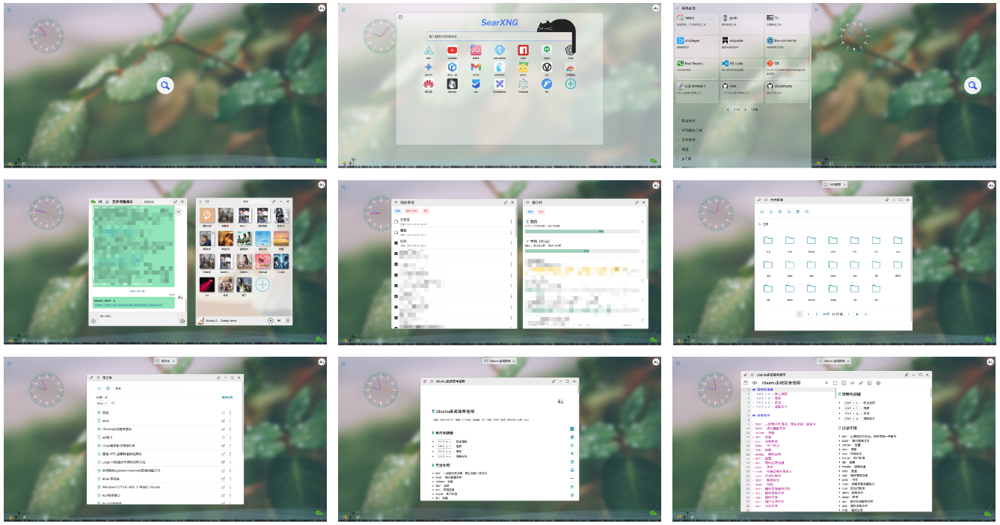

```
services:
  hello:
    image: 'ghcr.io/zxecsm/hello:latest'
    container_name: hello
    restart: unless-stopped
    environment:
      - TZ=Asia/Shanghai          # 时区
      # - UV_THREADPOOL_SIZE=12   # 文件处理并发 libuv 线程池大小，默认4
      # - COOKIE_SECURE=false     # HTTP 设为 false，否则无法登录；HTTPS 不设或设 true
      # - TRUST_PROXY=1           # 反向代理时解析真实客户端 IP，默认不信任任何代理头
      #                           #   不设置：直接访问 55555 / 无反向代理
      #                           #   1 或 proxy：信任直连的 1 层代理（端口只对 Nginx 开放）
      #                           #   2、3：信任 N 层代理
      #                           #   192.168.1.20 或 172.17.0.0/16：只信任指定代理（可逗号分隔）
      #                           #   兼容：true/all/on/yes 等同 1；loopback 等同 127.0.0.1,::1
      #                           # 注意：Nginx 需设置 X-Forwarded-For $proxy_add_x_forwarded_for
    volumes:
      - /proc:/app/proc:ro        # 读取宿主机系统信息（CPU、内存、负载等）
      - /:/app/app_data           # 应用数据和文件管理目录
    ports:
      - '55555:55555'
```

Nginx 反向代理 SSH 上传下载注意事项

SFTP 上传是流式转发，需关闭 Nginx 请求体缓冲，否则会等文件全部传到服务器后才开始写远端：

```
server {
    listen 80;
    server_name hello.example.com;
    client_max_body_size 0;        # 不限制上传大小，按需改成 10g 等

    location / {
        proxy_pass http://127.0.0.1:55555;                            # 后端地址
        proxy_http_version 1.1;                                       # 流式转发的前提，必须 1.1
        proxy_set_header Host $host;                                  # 透传域名
        proxy_set_header X-Forwarded-For $proxy_add_x_forwarded_for;  # 真实客户端 IP

        proxy_request_buffering off;   # 关键：请求体不缓冲，边收边转发
        proxy_buffering off;           # 响应不缓冲，下载立即开始
        proxy_read_timeout 3600s;      # 读超时，大文件/慢网络需放宽
        proxy_send_timeout 3600s;      # 写超时，上传大文件需放宽
    }
}
```

- `proxy_request_buffering off` 必须配合 `proxy_http_version 1.1`；前面还有 CDN / 多层代理时，那一层也要关缓冲。
- 反向代理时按需设置 `TRUST_PROXY`（见上方 compose 配置）。

歌词格式：
```
[00:00.00]歌词
[00:00.00]翻译
```

随机壁纸

```
http://localhost:55555/api/bg/r/d    # 桌面端壁纸
http://localhost:55555/api/bg/r/m    # 移动端壁纸
```

随机音乐

```
http://localhost:55555/api/music
```

获取网站图标

```
http://localhost:55555/api/icon?u=[https://]google.com
```

获取网站信息

```
http://localhost:55555/api/site-info?u=[https://]google.com
```

回显接口

```
http://localhost:55555/api/echo?msg=hello
```

添加书签窗口（用于扩展和油猴脚本添加书签）

```
http://localhost:55555/addbmk/#{{https://google.com}}
```

接收推送消息

```
GET： http://localhost:55555/api/s/<key>?text=消息内容
POST：http://localhost:55555/api/s/<key> body：{"text": "消息内容"}
```
