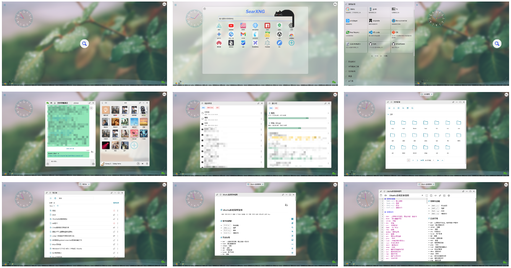

<h1 align="center">hello</h1>

<p align="center">
  一个集书签管理、创作笔记、任务提醒、终端管理、文件存储下载、音乐播放、<br>
  图片管理、图床、在线聊天和资源分享于一体的多功能个人门户网站。
</p>

<p align="center">
  <a href="docs/API.md">接口文档</a> ·
  <a href="#快速开始">快速开始</a> ·
  <a href="#环境变量">环境变量</a> ·
  <a href="#本地开发">本地开发</a> ·
  <a href="#打包成单个可执行文件">打包</a> ·
  <a href="#浏览器扩展与油猴脚本">扩展 / 油猴</a> ·
  <a href="#ai-技能">AI 技能</a>
</p>

## 功能

- **书签**：分组管理、站点图标与信息抓取、分享
- **笔记**：Markdown 编辑、历史记录、笔记本分类
- **待办 / 倒计时**：任务提醒与消息推送
- **文件**：上传下载、在线预览、回收站、文件分享
- **图片 / 图床**：图片管理、缩略图、外链
- **音乐**：播放列表、歌词、分享
- **终端**：SSH 连接管理、在线终端、SFTP 传输
- **聊天 / 分享**：站内聊天、接收外部推送
- **其他**：随机壁纸、用户管理、日志查看、PWA 支持

## 快速开始

Docker Compose：

```yaml
services:
  hello:
    image: 'ghcr.io/zxecsm/hello:latest'
    container_name: hello
    restart: unless-stopped
    environment:
      - TZ=Asia/Shanghai            # 时区
      - 'HOST=::'                   # 监听地址：:: 双栈；仅 IPv4 用 0.0.0.0；仅本机用 127.0.0.1
      - PORT=55555                  # 服务端口，修改后下方 ports 也要同步
      # - UV_THREADPOOL_SIZE=12     # 文件处理并发 libuv 线程池大小，默认 4
      # - COOKIE_SECURE=false       # HTTP 访问需设为 false，否则无法登录；HTTPS 不设或设 true
      # - TRUST_PROXY=1             # 反向代理时解析真实客户端 IP，默认不信任任何代理头
    volumes:
      - /proc:/app/proc:ro          # 读取宿主机系统信息（CPU、内存、负载等）
      - /:/app/app_data             # 应用数据和文件管理目录
    ports:
      - '55555:55555'               # 宿主机端口:容器端口（随 PORT 同步修改）
```

启动后浏览器访问 `http://localhost:55555`，首次启动会打印初始用户名和密码。

> `app_data` 是应用的数据目录，数据库、上传文件、图片、音乐等都保存在这里。
> 示例把宿主机根目录挂载进去，文件管理里可以直接浏览宿主机文件，请按需调整挂载范围。

## 环境变量

| 变量 | 默认值 | 说明 |
| --- | --- | --- |
| `TZ` | 系统时区 | 时区，例如 `Asia/Shanghai` |
| `HOST` | `::` | 监听地址。`::` 同时监听 IPv4 / IPv6；`0.0.0.0` 仅 IPv4；`127.0.0.1` / `::1` 仅本机 |
| `PORT` | `55555` | 服务端口，修改后 Docker `ports`、Nginx / Caddy 反代、前端开发代理需同步修改 |
| `UV_THREADPOOL_SIZE` | `4` | libuv 线程池大小，文件、图片处理并发高时可调大 |
| `COOKIE_SECURE` | 生产环境开启 | 仅通过 HTTPS 发送 Cookie。反向代理是 HTTP 时需设为 `false` |
| `TRUST_PROXY` | `off` | 反向代理下解析真实客户端 IP，详见下方说明 |
| `HELLO_DATA_DIR` | 可执行文件 / 服务端目录下的 `app_data` | 自定义数据目录，主要用于单文件可执行程序 |

<details>
<summary><b>TRUST_PROXY 说明</b></summary>

| 值 | 说明 |
| --- | --- |
| 不设置 / `off` | 不信任任何代理头，适合直接访问、无反向代理 |
| `1` / `proxy` | 信任直连的一层代理，应用端口只对 Nginx / Caddy 开放 |
| `2`、`3` … | 信任 N 层代理 |
| `192.168.1.20`、`172.17.0.0/16` | 只信任指定代理，多个用逗号分隔 |

兼容写法：`true` / `all` / `on` / `yes` 等同 `1`，`loopback` 等同 `127.0.0.1,::1`。
Nginx 需设置 `X-Forwarded-For $proxy_add_x_forwarded_for`；Caddy 会自动透传。

</details>

## 本地开发

需要 Node.js 22+。

### 安装依赖

在仓库根目录执行一次，会同时安装根目录、`server`、`web` 的依赖：

```bash
npm run setup
```

### 启动

```bash
npm run server   # 后端，默认监听 0.0.0.0:55555，启动时打印所有可访问地址
npm run web      # 前端开发模式，默认 http://localhost:55556
```

- 前后端都监听所有网卡，手机和同一局域网的设备可直接访问
- 可通过 `HOST`、`PORT` 覆盖后端监听地址和端口；修改 `PORT` 后前端开发代理会自动跟随
- 只想本机访问时设置 `HOST=127.0.0.1`

## 打包成单个可执行文件

### 打包

```bash
npm run exe
```

产物为 `dist/hello.exe`（macOS / Linux 上为 `dist/hello`），页面仍用浏览器访问，不内嵌 WebView。

- 使用 `@yao-pkg/pkg` 的 SEA 模式打包，目标机器无需安装 Node.js
- 在哪个系统上打包就生成哪个系统的可执行文件；跨平台打包需先安装对应平台的原生依赖（`sharp` 等）

### 运行

Windows：

- 双击 `hello.exe`，保持控制台窗口打开
- 或在命令行执行：

  ```bat
  hello.exe
  ```

macOS / Linux：

```bash
chmod +x ./hello
./hello
```

- 首次启动会打印初始用户名和密码，以及所有可访问地址（IPv4 / IPv6），用浏览器打开其中任意一个即可
- 关闭控制台窗口或按 `Ctrl + C` 停止服务
- macOS 首次运行被 Gatekeeper 拦截时，右键打开，或执行：
  `xattr -dr com.apple.quarantine ./hello`

### 数据目录

默认数据保存在可执行文件同目录的 `app_data`，首次运行自动创建。
可执行文件所在目录不可写（如 `Program Files`）时，可在 `hello.env` 中用 `HELLO_DATA_DIR` 指定其他目录。

### 配置文件

单文件程序会自动读取同目录下的 `hello.env`，首次运行会生成模板，之后改完文件直接双击程序即可。

```dotenv
# 监听地址：:: 双栈；0.0.0.0 仅 IPv4；127.0.0.1 仅本机
HOST=::

# 服务端口
PORT=55555

# HTTP 访问时设为 false
COOKIE_SECURE=false

# 数据目录，不填则使用程序同目录下的 app_data
# HELLO_DATA_DIR=D:\hello-data

# 反向代理时解析真实客户端 IP
# TRUST_PROXY=1
```

- 变量含义与上面的[环境变量](#环境变量)一致
- 修改 `hello.env` 后重新双击程序生效
- 命令行环境变量优先级更高，可临时覆盖文件配置
- `UV_THREADPOOL_SIZE`、`TZ` 需要由系统环境在启动前设置，写在 `hello.env` 中可能不生效
- 程序目录不可写、无法生成配置文件时，用命令行设置环境变量即可

## Nginx 反向代理

SFTP 上传是流式转发，需关闭 Nginx 的请求体缓冲，否则会等文件全部传到服务器后才开始写远端：

```nginx
server {
    listen 80;
    server_name hello.example.com;
    client_max_body_size 0;        # 不限制上传大小，按需改成 10g 等

    location / {
        proxy_pass http://127.0.0.1:55555;                            # 后端地址，随 PORT 修改
        proxy_http_version 1.1;                                       # 流式转发的前提，必须 1.1
        proxy_set_header Host $host;                                  # 透传域名
        proxy_set_header X-Forwarded-For $proxy_add_x_forwarded_for;  # 真实客户端 IP

        proxy_request_buffering off;   # 关键：请求体不缓冲，边收边转发
        proxy_buffering off;           # 响应不缓冲，下载立即开始
        proxy_read_timeout 3600s;      # 读超时，大文件/慢网络需放宽
        proxy_send_timeout 3600s;      # 写超时，上传大文件需放宽
    }
}
```

- `proxy_request_buffering off` 必须配合 `proxy_http_version 1.1`；前面还有 CDN / 多层代理时，那一层也要关闭缓冲
- 反向代理时按需设置 `TRUST_PROXY`（见 [环境变量](#环境变量)）

## Caddy 反向代理

Caddy 会自动申请和续期 HTTPS 证书，并默认透传 `X-Forwarded-For`。SFTP 上传是流式转发，需要关闭响应缓冲：

```caddyfile
hello.example.com {
    # 不需要压缩时删掉 @compressible 和 encode 两段
    @compressible {
        not path /api/f* /api/music*
    }
    encode @compressible zstd gzip

    reverse_proxy 127.0.0.1:55555 {
        # 不缓冲响应，下载/流式接口立即开始
        flush_interval -1
    }
}
```

- Caddy 默认不缓冲请求体，大文件上传可以直接流式转发
- 如需限制上传大小，可在 `reverse_proxy` 前加 `request_body { max_size 10GB }`
- 反向代理时按需设置 `TRUST_PROXY=1`（见 [环境变量](#环境变量)）

## 接口

完整接口文档见 **[docs/API.md](docs/API.md)**。

| 接口 | 说明 |
| --- | --- |
| `GET /api/bg/r/d` | 随机桌面壁纸 |
| `GET /api/bg/r/m` | 随机移动端壁纸 |
| `GET /api/music` | 随机音乐 |
| `GET /api/icon?u=https://google.com` | 获取网站图标 |
| `GET /api/site-info?u=https://google.com` | 获取网站信息 |
| `GET /api/echo?msg=hello` | 回显接口 |
| `GET /addbmk/#{{https://google.com}}` | 添加书签窗口（浏览器扩展 / 油猴脚本） |
| `GET /api/s/<key>?text=消息内容` | 接收推送消息 |
| `POST /api/s/<key>` | 接收推送消息，body：`{"text": "消息内容"}` |

> 以上地址默认端口为 `55555`，修改 `PORT` 后请替换。

## 浏览器扩展与油猴脚本

把当前页面一键保存为 Hello 书签，或把选中的文字推送到 Hello。

### 浏览器扩展（Chrome / Edge）

源码在 [`expand`](expand) 目录（Manifest V3）。

1. 打开扩展管理页：`chrome://extensions` 或 `edge://extensions`
2. 打开「开发者模式」
3. 点击「加载已解压的扩展程序」，选择仓库中的 `expand` 目录
4. 点击工具栏中的 **Save to Hello** 图标，填写 API 地址：

   ```text
   http://192.168.1.10:55555/addbmk/#{{}}
   ```

   `{{}}` 会被替换为当前页面的 URL；地址和端口请按实际部署修改

5. 打开任意网页，点击扩展图标 →「保存当前页面」（需先在浏览器登录 Hello）

### 油猴脚本（Tampermonkey）

脚本在 [`monkey/index.js`](monkey/index.js)：选中文字后弹出工具箱，支持复制、搜索、翻译、保存书签、推送消息。

1. 安装 [Tampermonkey](https://www.tampermonkey.net/)（或 Violentmonkey）
2. 新建脚本，把 `monkey/index.js` 的内容粘贴进去并保存
3. 修改脚本中的接口地址：

   ```js
   const SAVEBMK_API = 'http://192.168.1.10:55555/addbmk/#{{}}';
   const PUSH_API = 'http://192.168.1.10:55555/api/s/<收信key>?text={{}}';
   ```

4. 收信 key 获取方式：在 Hello 聊天中给「服务通知」发送 `update`，回复会给出 `/api/s/<key>` 地址；
   `stop` 关闭收信接口，`start` 重新开启
5. 在任意页面选中文字，点击工具箱中的按钮即可

> 扩展和脚本都需要先在浏览器登录 Hello；Hello 不在本机时不要使用 `localhost`。
> 地址中的端口需与 `PORT` 保持一致。

## AI 技能

项目内置 OpenCode 技能 `.opencode/skills/hello-api`，让智能体通过 HTTP API 操作
书签、笔记、待办、文件、分享、剪切板等，不用手写请求，也不会直接改数据库。

用 OpenCode 打开本项目时会自动加载该技能。

### 配置

首次使用先准备连接信息：

```powershell
Copy-Item .opencode\skills\hello-api\scripts\.env.example `
          .opencode\skills\hello-api\scripts\.env
```

#### 获取 token

推荐直接在页面生成：

1. 登录 Hello，打开「账号管理」
2. 点击「生成认证token」
3. 输入过期天数（`1–3650`），确认后弹窗显示 token 并自动全选
4. 点击「复制」，填入 `.env`（已被 `.gitignore` 忽略，**不要提交**）：

   ```dotenv
   HELLO_BASE_URL=http://localhost:55555
   HELLO_COOKIE=token=粘贴的token
   ```

也可以用接口生成（适合脚本 / 自动化）。在 Hello 页面打开浏览器控制台执行：

```js
fetch('/api/user/create-token', {
  method: 'POST',
  headers: { 'Content-Type': 'application/json' },
  body: JSON.stringify({ days: 30 }),
})
  .then((r) => r.json())
  .then((r) => console.log(r.data));
```

- `days` 范围 `1–3650`，按需选择有效期
- 已有可用 token 时，可以用 CLI 续期：

  ```powershell
  node .opencode\skills\hello-api\scripts\hello.mjs api POST /api/user/create-token --set days=30
  ```

- 也可以直接复制浏览器 Cookie（`token=...`），但浏览器 Cookie 默认只有 2 天

#### token 失效情况

| 情况 | 说明 |
| --- | --- |
| 到达 `days` 天 | JWT 到期，返回 `未登录或登录态已过期`，需重新生成 |
| 修改密码 | 之前签发的 token 全部失效 |
| 邮箱重置密码 | 之前签发的 token 全部失效 |
| 退出其他设备 | 之前签发的 token 全部失效 |
| 账号被禁用 / 删除 | 无法加载用户信息，token 失效 |
| 重置或删除 `app_data` | 加密密钥重新生成，所有旧 token 无法解密 |
| 仅退出当前设备 | 只清除浏览器 Cookie，已导出的 token 仍然有效 |
| 服务重启 | 不影响 token；修改地址或端口后需同步更新 `HELLO_BASE_URL` |

> 浏览器登录 Cookie 默认 2 天，并在使用中自动续期；通过页面或接口生成的 token 不会自动续期，
> 到期或失效后重新生成即可。

### 使用

在 OpenCode 中直接描述要做什么即可，例如：

- “查一下我的书签，按分组列出来”
- “把这段内容整理成笔记，标题叫周报”
- “新增一个待办：整理接口文档”
- “把这段文字同步到剪切板”

也可以手动调用 CLI 调试：

```powershell
[Console]::OutputEncoding = [Text.Encoding]::UTF8

node .opencode\skills\hello-api\scripts\hello.mjs config
node .opencode\skills\hello-api\scripts\hello.mjs whoami
node .opencode\skills\hello-api\scripts\hello.mjs bmk groups
node .opencode\skills\hello-api\scripts\hello.mjs todo list
node .opencode\skills\hello-api\scripts\hello.mjs file ls --path /
```

调用未封装的接口：

```powershell
node .opencode\skills\hello-api\scripts\hello.mjs api GET /api/bmk/list --query id=<分组id>
node .opencode\skills\hello-api\scripts\hello.mjs api POST /api/todo/add --set content=整理接口文档
```

### 安全说明

- `.env`、`.hello-session.json`、`hello.config.json` 已忽略，智能体不会读取 Cookie 明文
- 新增 / 修改 / 删除等写操作会先征得确认，删除类命令必须显式加 `--yes`
- 默认不调用 `/api/root/*` 管理写接口
- Cookie 等同于登录凭证，不要提交到仓库或粘贴到对话里

详见 [SKILL.md](.opencode/skills/hello-api/SKILL.md)、
[接口参考](.opencode/skills/hello-api/references/api.md)、
[全部路由](.opencode/skills/hello-api/references/routes.md)。

## 歌词格式

```text
[00:00.00]歌词
[00:00.00]翻译
```
