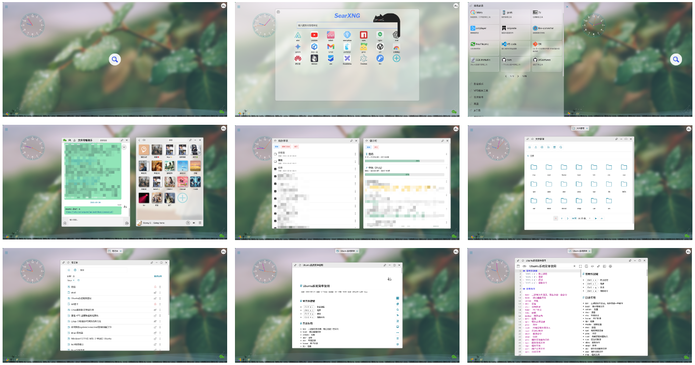

# Hello 使用说明

> 这是一份可以随时回来查看的功能速查笔记，按使用场景整理了主页操作和笔记功能。

::: tip 快速跳转
- [主页快捷键](#主页快捷键)
- [标题与锚点](#标题与锚点)
- [文本样式](#文本样式)
- [列表与任务](#列表与任务)
- [引用与代码](#引用与代码)
- [链接与图片](#链接与图片)
- [表格](#表格)
- [提示容器](#提示容器)
- [折叠内容](#折叠内容)
- [脚注与定义列表](#脚注与定义列表)
- [HTML](#html)
:::

## 主页快捷键

| 快捷键 | 功能 | 快捷键 | 功能 |
| :--- | :--- | :--- | :--- |
| <kbd>a</kbd> | 打开/关闭左侧菜单 | <kbd>b</kbd> | 书签夹 |
| <kbd>c</kbd> | 聊天室 | <kbd>e</kbd> | 新建笔记 |
| <kbd>f</kbd> | 文件管理 | <kbd>h</kbd> | 搜索历史 |
| <kbd>l</kbd> | 日志 | <kbd>m</kbd> | 播放器切换 |
| <kbd>n</kbd> | 笔记本 | <kbd>o</kbd> | 关闭播放器 |
| <kbd>p</kbd> | 图床 | <kbd>q</kbd> | 隐藏所有窗口 |
| <kbd>r</kbd> | 切换播放模式 | <kbd>s</kbd> | 打开/关闭搜索框 |
| <kbd>t</kbd> | 终端管理 | <kbd>u</kbd> | 用户管理 |
| <kbd>x</kbd> | 关闭所有窗口 | <kbd>space</kbd> | 播放/暂停 |
| <kbd>Ctrl</kbd> + <kbd>↑</kbd>/<kbd>↓</kbd> | 音量调节 | <kbd>Ctrl</kbd> + <kbd>←</kbd>/<kbd>→</kbd> | 上一曲/下一曲 |

手势操作：

- 上滑：打开音乐播放器
- 下滑：打开壁纸库
- 右滑：打开左边菜单
- 左滑：打开设置菜单

## 标题与锚点

```markdown
# 一级标题
## 二级标题
### 三级标题
```

每个标题都会根据标题文字自动生成锚点 id，可以在笔记里直接跳转：

```markdown
[跳转到表格](#表格)
[回到顶部](#hello-使用说明)
```

中文会保留在 id 里，空格和标点会转成连字符，重复标题会自动加后缀。

## 文本样式

| 样式 | 写法 | 效果 |
| :--- | :--- | :--- |
| 斜体 | `*斜体*` 或 `_斜体_` | *斜体* |
| 粗体 | `**粗体**` 或 `__粗体__` | **粗体** |
| 粗斜体 | `***粗斜体***` | ***粗斜体*** |
| 删除线 | `~~删除线~~` | ~~删除线~~ |
| 行内代码 | `` `单行内联代码` `` | `单行内联代码` |
| 上标 | `2^10^ = 1024` | 2^10^ = 1024 |
| 下标 | `H~2~O` | H~2~O |
| 高亮 | `==高亮内容==` | ==高亮内容== |
| 插入线 | `++插入内容++` | ++插入内容++ |
| Emoji | `:smile: :rocket: :tada:` | :smile: :rocket: :tada: |

## 列表与任务

```markdown
- 无序列表项
- 无序列表项

1. 有序列表项
2. 有序列表项

- [ ] 未完成的任务
- [x] 已完成的任务
```

- 无序列表项
- 无序列表项

1. 有序列表项
2. 有序列表项

- [ ] 未完成的任务
- [x] 已完成的任务

## 引用与代码

引用：

```markdown
> 这是一段引用文本
>
> > 这是一段嵌套引用
```

> 这是一段引用文本
>
> > 这是一段嵌套引用

代码块：

````markdown
```javascript
console.log('Hello, World!');
```
````

```javascript
console.log('Hello, World!');
```

## 链接与图片

```markdown
[Hello 项目地址](https://github.com/zxecsm/hello)


```

[Hello 项目地址](https://github.com/zxecsm/hello)


## 表格

```markdown
| 语法 | 说明 |
| :--- | :--- |
| 斜体 | *斜体* |
| 粗体 | **粗体** |
```

| 语法 | 说明 |
| :--- | :--- |
| 斜体 | *斜体* |
| 粗体 | **粗体** |
| 行内代码 | `代码` |
| 链接 | [Hello](https://github.com/zxecsm/hello) |

表格内容较多时会自动横向滚动。

## 提示容器

::: tip 提示
适合放补充说明、使用技巧或者阅读提示。
:::

::: info 说明
适合放背景信息、参数说明等中性内容。
:::

::: warning 注意
适合放容易出错、需要留意的地方。
:::

::: danger 警告
适合放危险操作或不可恢复的操作提醒。
:::

## 折叠内容

::: details 展开查看示例代码
```javascript
function greet(name) {
  return `Hello, ${name}`;
}
```
:::

折叠块默认收起，点击标题即可展开。

## 脚注与定义列表

正文可以添加脚注[^1]。

Markdown
: 一种轻量级标记语言，适合记录笔记和文档。

Hello
: 本项目名称，也是一个自托管的主页应用。

*[HTML]: HyperText Markup Language
*[CSS]: Cascading Style Sheets

HTML 和 CSS 是网页的基础。

[^1]: 脚注会统一显示在文末，并自动编号和生成返回链接。

## HTML

在安全白名单内可以直接书写 HTML，例如键盘按键：<kbd>Ctrl</kbd> + <kbd>S</kbd>，或者使用 <mark>高亮标签</mark>。

---

[回到顶部](#hello-使用说明)
